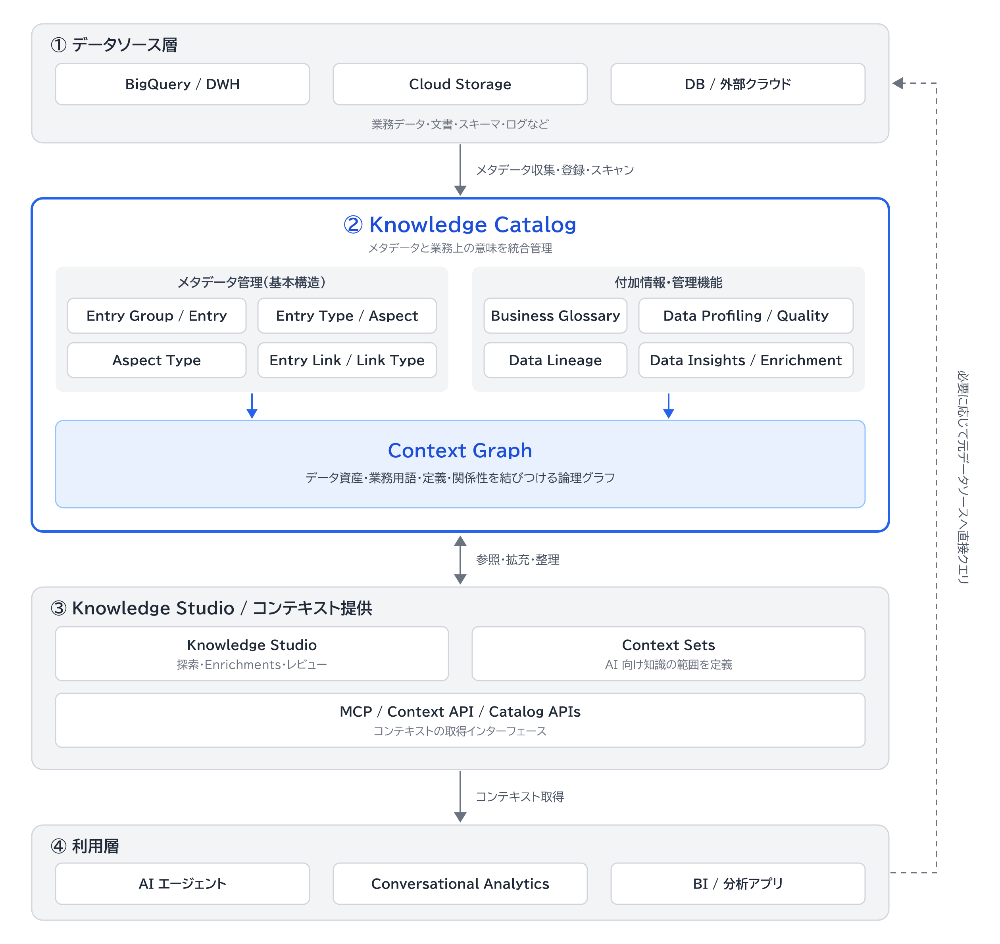

# Knowledge Catalog の全体像

問い: Knowledge Catalog に関係するコンポーネント・サービスと、内部の構成はどうなっているか。

Knowledge Catalog は、さまざまなデータソースからメタデータを収集し、業務上の意味やデータ間の関係性を整理して、AI エージェントや分析ツールに提供する Google Cloud のサービスです。
メタデータの「収集→拡充→提供」というライフサイクルが基本構造です。

## 4 つの層

| 層 | 含まれるもの |
|---|---|
| ① データソース層 | BigQuery、Cloud Storage、外部 DB など |
| ② Knowledge Catalog 層 | メタデータ管理、関係性管理、品質管理 |
| ③ コンテキスト整備・提供層 | Knowledge Studio、Context Sets、MCP など |
| ④ 利用層 | AI エージェント、Conversational Analytics、BI など |

## 全体構成図

関連サービスと内部構成を統合した概念図です。

層は概念上の区分です。
Knowledge Studio と Context Sets は Knowledge Catalog と一体的に機能し、独立したデータ保存基盤ではありません。
データソース層が扱うのは業務データ・文書・スキーマ・ログなどです。
利用層のアプリは、必要に応じて元データソースへ直接クエリを実行します。

## 内部構成

データを表す仕組みと、データに意味を付与する仕組みを区別します。

| コンポーネント | 役割 | 具体例 |
|---|---|---|
| Entry Group | Entry をまとめる管理単位 | 販売データ群 |
| Entry | データ資産を表現 | 売上テーブル |
| Entry Type | Entry の種類・構造を定義 | BigQuery Table |
| Aspect Type | メタデータの項目構造を定義 | 管理責任者、更新頻度 |
| Aspect | 実際のメタデータ | 管理責任者＝営業部 |
| Entry Link | データや概念の関係を表す | 売上→店舗 |
| Business Glossary | 業務用語・定義を管理 | 売上＝返品控除後金額 |
| Context Graph | 上記の資産・意味・関係性を統合 | 売上・店舗・商品間の関係 |

## 関連サービスの位置づけ

Knowledge Catalog そのものと、周辺のサービス・機能を分けて捉えます。

| サービス・機能 | 主な役割 |
|---|---|
| BigQuery | 業務データの保存・SQL 分析 |
| Cloud Storage | 文書やファイルの保存 |
| Data Lineage | データの生成元・加工・移動経路 |
| Data Profiling | データの統計的特徴を調査 |
| Data Quality | データ品質を検証 |
| BigQuery Data Insights | AI によるテーブル説明・SQL 例などの生成 |
| Knowledge Studio | コンテキストの探索・拡充・レビュー |
| Context Sets | AI に渡す知識の範囲を整理 |
| MCP / Context API | AI がコンテキストを取得するための接続手段 |

## 次に深める点

内部構成を中心に、各コンポーネントの包含関係・参照関係・データフローを区別した詳細図を作ると、Entry Group、Context Sets、Context Graph の関係が明確になります。

公式ドキュメントへのリンクは [README](../README.md) にあります。
