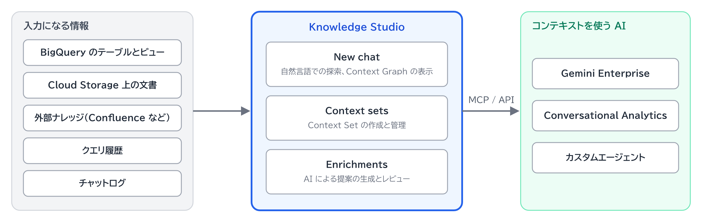

# Knowledge Studio

[全体像](../全体像.md) › ③ コンテキスト整備・提供層

企業のメタデータをキュレーションして統合し、生成 AI アプリを業務のコンテキストに[グラウンディング](../glossary/グラウンディング.md)させるための画面。\
Preview の機能。

## 3 つの領域

| 領域 | できること | 例 |
|---|---|---|
| New chat | 自然言語でのデータ探索と、[Context Graph](Context-Graph.md) の表示 | 「顧客の注文データはどこにあるか」と尋ねる |
| Context sets | [Context Sets](Context-Sets.md) の作成と管理 | 販売分析用の Context Set を作る |
| Enrichments | [エンリッチメントタスク](エンリッチメントタスク.md) と評価ベンチマークの設定、AI が提案した変更のレビュー | 提案された列の説明を承認する |

## 入力になる情報

- BigQuery のテーブルとビュー、Lakehouse、データベース
- Cloud Storage 上の文書
- Confluence、Jira、GitHub などの外部ナレッジ
- Cloud Logging などのクエリ履歴
- Gemini Enterprise のチャットログ、BigQuery の agent analytics

## 関連

- 公式ドキュメント: [Knowledge Studio](https://docs.cloud.google.com/knowledge-catalog/docs/knowledge-studio)
