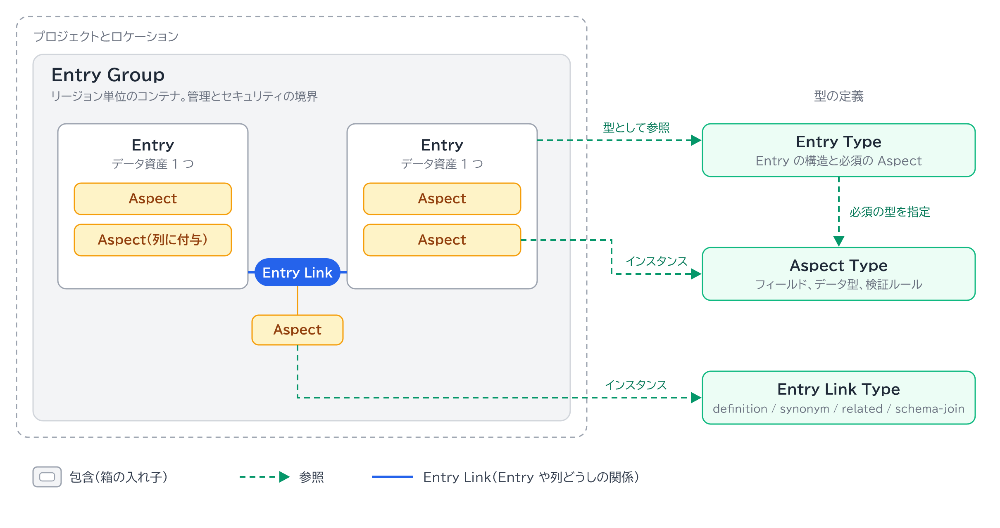

# コンポーネント間の関係

[メタデータモデル](metadata-model.md) の要素は、包含と参照の 2 種類の関係でつながります。

## 包含

| 入れ物 | 中身 |
|---|---|
| プロジェクトとロケーション | Entry Group |
| Entry Group | Entry、Entry Link |
| Entry | Aspect、列 |
| Entry Link | Aspect |

Entry の識別子は、親の Entry Group の中で一意です。
[Context Sets](context-sets.md) は特殊な Entry Group で、同じ包含関係に従います。

## 参照

| 参照元 | 参照先 | 関係 |
|---|---|---|
| Entry | Entry Type | 型として参照する。作成時に必須の Aspect が揃っているか検証される |
| Aspect | Aspect Type | インスタンスである |
| Entry Type | Aspect Type | 必須にする Aspect Type を指定する |
| Entry Link | Entry または列 | 2 つを結ぶ |
| Entry Link | Entry Link Type | インスタンスである |

## ロケーションとプロジェクトの制約

| 関係 | 制約 |
|---|---|
| Entry と Entry Type | ロケーションが一致するか、Entry Type が `global`。Entry Type は `global` か同じプロジェクトのもの |
| Aspect と Aspect Type | Aspect Type が Entry と同じロケーションか `global`。`global` か同じプロジェクトのもの |
| Entry Link と Entry Link Type | ロケーションが一致するか、Entry Link Type が `global` |
| Entry Link と Entry | 同じ組織内なら、別プロジェクトの Entry どうしを結べる |
| Entry Type と Aspect Type | 同じロケーションか `global` の Aspect Type で構成する。カスタムの Aspect Type は同じプロジェクトとロケーションのもの |

## 関連

- [全体像](../overview.md) の層②
- メタデータが流れる順序: [メタデータのライフサイクル](metadata-lifecycle.md)
- 公式ドキュメント（2026-11-13 確認）: [メタデータモデル](https://docs.cloud.google.com/knowledge-catalog/docs/metadata-overview)
