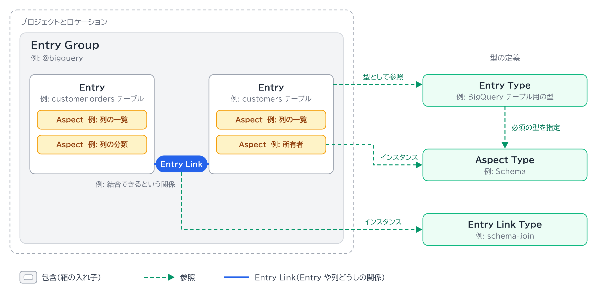

# メタデータモデル

[全体像](../overview.md) › ② Knowledge Catalog 層

Knowledge Catalog は、データ資産を Entry として表し、Aspect でメタデータを付け、Entry Link で資産どうしの関係を表します。

## 構成要素

例は、BigQuery のテーブル `orders_project.sales.customer_orders` が登録された場合です。

| 要素 | 定義 | 例 |
|---|---|---|
| Entry Group | Entry と Entry Link を入れるリージョン単位のコンテナ。管理とセキュリティの境界になる | BigQuery 用に自動で作られる `@bigquery` |
| Entry | 単一のデータ資産を表す | `customer_orders` テーブルを指す 1 件の登録 |
| Entry Type | Entry の構造と必須の Aspect を定めるテンプレート | BigQuery テーブル用の型 |
| Aspect Type | Aspect のフィールド、データ型、検証ルールを定める再利用可能なスキーマ | `Schema`。列名、型、説明という項目を定める |
| Aspect | Aspect Type に従う、関連するメタデータフィールドの集まり | `customer_orders` の列の一覧。`email_address` 列に付けた「機密情報」という分類 |
| Entry Link | 2 つの Entry、または Entry 内の列どうしの意味的な関係 | `customer_orders` と `customers` テーブルが結合できるという関係 |
| Entry Link Type | Entry Link の種類 | `schema-join` |

Entry の識別子は、親の Entry Group の中で一意です。\
Entry を作るときは、Entry Type が必須とする Aspect が揃っているか検証されます。

## Aspect の付与先

Aspect は Entry、Entry の列、Entry Link の 3 か所に付きます。\
列は `schema` の Aspect を Entry に付けると生成され、ネストは `customer.address.postal_code` のようにドットで表します。\
`schema-join` の Entry Link には Aspect を付けられません。

## Entry Link Type

| 種類 | 用途 | 方向 | 例 |
|---|---|---|---|
| `definition` | ビジネス用語集の定義を、物理的な列や Entry に結ぶ | あり | 用語「顧客メールアドレス」を `email_address` 列に結ぶ |
| `synonym` | 同等の業務概念や別名の用語を結ぶ | なし | 「顧客」と「取引先」を結ぶ |
| `related` | システムをまたぐ、ゆるく関連する資産を結ぶ | なし | 注文テーブルと、別システムの出荷データを結ぶ |
| `schema-join` | 外部キーなどで結合できるテーブルを結ぶ | なし | `customer_orders` と `customers` を結ぶ |

## システム提供とユーザー定義

| 要素 | システム提供 | ユーザー定義 |
|---|---|---|
| Entry Group | `@bigquery`、`@spanner`、`@pubsub` など。プロジェクトごとに作られる | カスタム資産と権限管理のために作る |
| Entry Type | Google Cloud のリソース種別を表す型 | カスタム資産向けに必須・任意の Aspect を定める |
| Aspect Type | `Schema`、`Overview`、`Contacts`、`DataQuality`、`Lineage` など | PII 分類や SLA の階層など |
| Aspect | ソースシステム、クエリログ、自動スキャンから作られる | 利用者、パイプライン、エージェントが付ける |

## 関連

- 公式ドキュメント（2026-11-13 確認）: [メタデータモデル](https://docs.cloud.google.com/knowledge-catalog/docs/metadata-overview)
