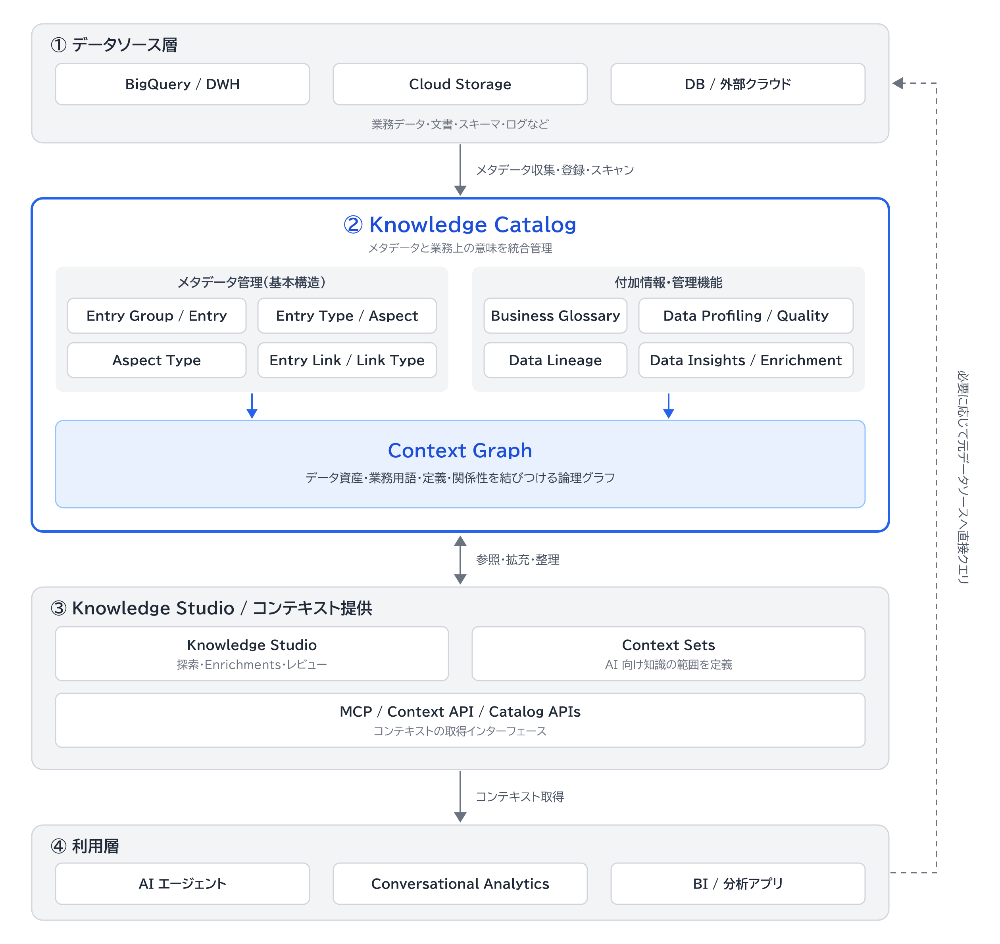

# Knowledge Catalog の全体像

Knowledge Catalog は、さまざまなデータソースからメタデータを収集し、業務上の意味やデータ間の関係性を整理して、AI エージェントや分析ツールに提供する Google Cloud のサービスです。
メタデータの「収集→拡充→提供」というライフサイクルが基本構造です。

## 4 つの層

| 層 | 構成要素 | 資料 |
|---|---|---|
| ① データソース層 | BigQuery、Cloud Storage、外部 DB など | [データソース](architecture/data-sources.md) |
| ② Knowledge Catalog 層 | メタデータ管理 | [メタデータモデル](architecture/metadata-model.md) |
| ② Knowledge Catalog 層 | 付加情報・管理機能 | [付加情報・管理機能](architecture/enrichment-features.md) |
| ② Knowledge Catalog 層 | Context Graph | [Context Graph](architecture/context-graph.md) |
| ③ コンテキスト整備・提供層 | Knowledge Studio、Context Sets、MCP など | [コンテキストの整備と提供](architecture/context-delivery.md) |
| ④ 利用層 | AI エージェント、Conversational Analytics、BI など | [利用側](architecture/consumers.md) |

層は概念上の区分です。

## 全体構成図

## 関連

- 公式ドキュメント: [Knowledge Catalog の概要・アーキテクチャ](https://docs.cloud.google.com/knowledge-catalog/docs/introduction?hl=ja)
