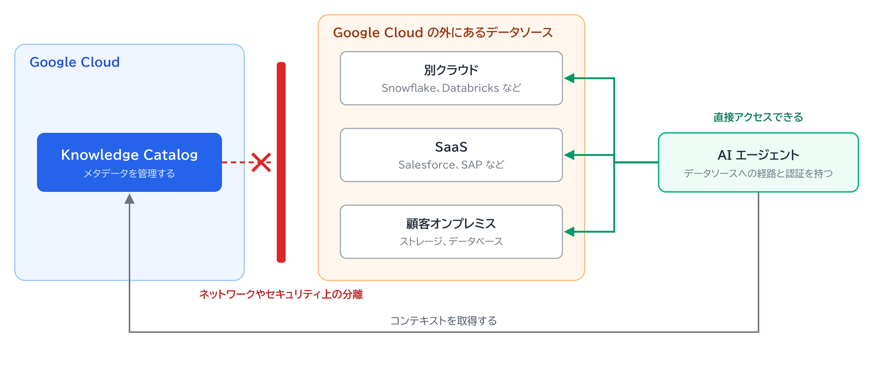

# 分離された外部データソースという状況は起こるか

## 前提

データソースが、別クラウド、Salesforce や SAP などの SaaS、顧客オンプレミスのストレージにあるとします。
AI エージェントからは直接アクセスできますが、Knowledge Catalog とはネットワークやセキュリティ上で分離されています。

## 問い

こうした状況は、実際に発生しうるか。

## 回答

発生しえます。
エージェントとカタログでは、データソースへの到達経路が別だからです。
次の表は公式ドキュメントの記述ではなく、構成から考えた例です。

| データソース | エージェント側 | カタログ側 |
|---|---|---|
| Salesforce や SAP などの SaaS | SaaS の API に OAuth などで直接つなぐ | そのプロジェクトには接続がない |
| 別クラウドの Snowflake や Databricks | 直接クエリする | ネットワークから到達できない |
| 顧客オンプレミスのストレージ | 顧客の環境内で動く | Google Cloud からオンプレミスへ入る経路が許可されていない |

## 関連

- この状況での取り込み方法: [分離された外部データソースからのメタデータ取り込み](isolated-external-sources-ingestion.md)
