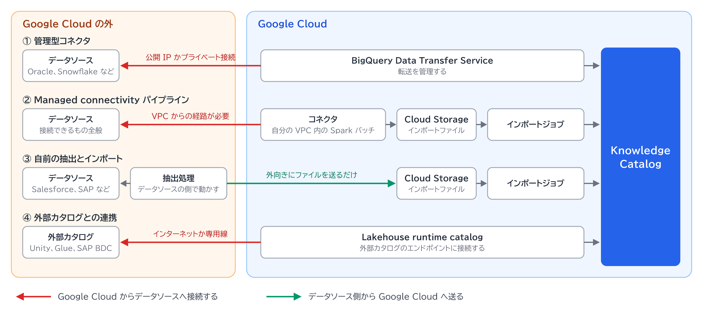

# 分離された外部データソースからのメタデータ取り込み

[全体像](../全体像.md) › ① データソース層

## 前提

データソースが Google Cloud の外にあり、AI エージェントからは直接アクセスできますが、Knowledge Catalog とは分離されています。\
状況の詳細は [分離された外部データソースという状況は起こるか](分離された外部データソースという状況は起こるか.md) にあります。

## 問い

この状況で、Knowledge Catalog へのメタデータの収集・登録・スキャンはどう行えばよいか。

## 回答

Knowledge Catalog 自身がデータソースへ取りに行くのではなく、データソースに届く場所で抽出し、メタデータだけを渡します。\
方法は 4 つあり、Google Cloud からデータソースへ接続できるかどうかで選びます。\
スキャンの対象は BigQuery などのテーブルに限られます。

| 方法 | 仕組み | 接続の向き |
|---|---|---|
| ① 管理型コネクタ | BigQuery Data Transfer Service が転送を管理し、指定した Entry Group に取り込む | Google Cloud からデータソースへ |
| ② Managed connectivity パイプライン | 自分のコネクタを Spark のバッチとして VPC 内で動かす。抽出結果を Cloud Storage に書き、インポートジョブで取り込む | Google Cloud からデータソースへ |
| ③ 自前の抽出とインポート | 自分のパイプラインで抽出したメタデータを JSON Lines のファイルにし、Cloud Storage に置いてインポートジョブを実行する | データソース側から Google Cloud へ |
| ④ 外部カタログとの連携 | Lakehouse runtime catalog が外部の Iceberg REST Catalog に接続し、メタデータとリネージを Knowledge Catalog に同期する | Google Cloud から外部カタログへ |

取り込まれるのはメタデータだけで、実データは移動しません。

出典: [コネクタ](https://docs.cloud.google.com/knowledge-catalog/docs/connectors)、[Managed connectivity](https://docs.cloud.google.com/knowledge-catalog/docs/managed-connectivity-overview)、[メタデータのインポート](https://docs.cloud.google.com/knowledge-catalog/docs/import-metadata)、[クロスクラウドのデータアクセス](https://docs.cloud.google.com/lakehouse/docs/about-cross-cloud-data-access)

### ① 管理型コネクタ

対応するデータソースは Databricks Unity Catalog、dbt、MySQL、Oracle、PostgreSQL、Snowflake Horizon、SQL Server です。

| 項目 | 内容 |
|---|---|
| 接続 | 公開 IP ならそのまま接続する。プライベートに接続するには、Private Service Connect の network attachment を用意する |
| オンプレミス | Oracle のコネクタは、オンプレミス、Google Cloud、他クラウドのインスタンスに対応する |
| 認証 | Oracle はユーザー名とパスワード。Snowflake Horizon はキーペア認証だけ |
| 同期 | 実行のたびに Entry Group を全量で上書きする。増分更新はできない |
| 料金 | コネクタでの取り込みに追加料金はない。メタデータの保存には通常の料金がかかる |

出典: [コネクタ](https://docs.cloud.google.com/knowledge-catalog/docs/connectors)、[Oracle のコネクタ](https://docs.cloud.google.com/knowledge-catalog/docs/oracle-transfer)、[Snowflake Horizon のコネクタ](https://docs.cloud.google.com/knowledge-catalog/docs/snowflake-horizon-transfer)

### ② Managed connectivity パイプライン

コネクタがないデータソースには、自分でコネクタを作ります。\
Workflows が順序を制御し、Cloud Scheduler で定期実行できます。

| 項目 | 内容 |
|---|---|
| コネクタ | Artifact Registry に置いたイメージ。Python、Java、Scala、R で書ける |
| ネットワーク | `NETWORK_URI` か `SUBNETWORK_URI` で、データソースに接続する VPC を指定する |
| Spark バッチの制約 | VM は内部 IP だけを持つ。外部へ出るには Cloud NAT を設定する |
| 認証情報 | Secret Manager に保存する |
| 同期 | Entry は全量、Aspect は増分 |

VPC からオンプレミスや他クラウドへの経路の作り方は、公式ドキュメントに書かれていません。\
AWS Glue や Snowflake 向けなどのコミュニティ製コネクタが GitHub にありますが、Google の公式サポート対象外です。

出典: [Managed connectivity](https://docs.cloud.google.com/knowledge-catalog/docs/managed-connectivity-overview)、[ワークフローでのインポート](https://docs.cloud.google.com/knowledge-catalog/docs/import-using-workflows-custom-source)、[カスタムコネクタの開発](https://docs.cloud.google.com/knowledge-catalog/docs/develop-custom-connector)、[Spark バッチのネットワーク](https://docs.cloud.google.com/dataproc-serverless/docs/concepts/network)

### ③ 自前の抽出とインポート

Google Cloud からデータソースへ入る経路を作れないときの方法です。\
公式ドキュメントは抽出を行う場所を限定しておらず、決まっているのはファイルを Cloud Storage に置くことだけです。\
抽出をデータソースの側で動かせば、必要な通信は外向きのファイル送信だけになります。

| 項目 | 内容 |
|---|---|
| ファイル形式 | JSON Lines、UTF-8。1 ファイル 1 GiB 未満、1 ジョブで 3 GB まで |
| 事前に作るもの | Entry Group、Entry Type、Aspect Type |
| 実行 | `metadataJobs` API でインポートジョブを作る。Entry Group とジョブは同じリージョンにする |
| 全量同期 | カスタムの Entry が対象。ファイルにない既存の Entry は削除される。ファイルが空なら、対象範囲の Entry がすべて削除される |
| 少量の登録 | `entries.create` や gcloud で 1 件ずつ作る。コンソールからは作れない |

カスタムの Entry は、オンプレミスなど Google Cloud の外にあるリソースを表すためのものと明記されています。

出典: [メタデータのインポート](https://docs.cloud.google.com/knowledge-catalog/docs/import-metadata)、[カスタムソースの取り込み](https://docs.cloud.google.com/knowledge-catalog/docs/ingest-custom-sources)

### ④ 外部カタログとの連携

データソースが外部のカタログで管理されている場合の方法です。

| 項目 | 内容 |
|---|---|
| 対応するカタログ | Databricks Unity Catalog、AWS Glue、Snowflake Horizon Catalog、Workday Data Lake、SAP Business Data Cloud |
| 接続 | 既定はインターネット経由の TLS。専用線も使える |
| 認証 | OIDC か Secret Manager |
| 提供段階 | Databricks Unity、AWS Glue、Snowflake Horizon の連携は Preview |

出典: [クロスクラウドのデータアクセス](https://docs.cloud.google.com/lakehouse/docs/about-cross-cloud-data-access)、[メタデータモデル](https://docs.cloud.google.com/knowledge-catalog/docs/metadata-overview)

### データソースごとの対応

各方法の出典をもとに整理した表です。

| データソース | 使える方法 |
|---|---|
| Salesforce | コネクタも連携の設定手順も見つからない。② か ③ |
| SAP | SAP Business Data Cloud は ④。SAP HANA や S/4HANA は記載がなく、② か ③ |
| Snowflake、Databricks | ① か ④ |
| AWS Glue | ④ |
| オンプレミスの Oracle、MySQL、PostgreSQL、SQL Server | ①。経路を開けられなければ ③ |
| オンプレミスのファイルストレージ | コネクタがない。② か ③ |

### スキャン

データプロファイリングと自動データ品質のスキャンは、対象が次のテーブルに限られます。\
オンプレミスや SaaS のデータを直接スキャンする方法は、公式ドキュメントに書かれていません。

| スキャン | 対象にできるテーブル |
|---|---|
| データプロファイリング | BigQuery のテーブル。Lakehouse が管理する Apache Iceberg、Apache Hive、SAP BDC Delta Lake のテーブル |
| 自動データ品質 | BigQuery、Iceberg REST Catalog、SAP BDC Delta Lake、Apache Hive のテーブル |

④ で連携した外部カタログのテーブルがスキャンの対象に入るかは確認できていません。\
Snowflake Horizon のコネクタは、Snowflake 側のデータ品質とプロファイリングの情報をメタデータとして取り込みます。\
それ以外のデータソースでは、データソース側で計算した結果を Aspect として ③ で取り込む形が考えられます。\
この方法は公式ドキュメントには書かれていません。

出典: [データプロファイリング](https://docs.cloud.google.com/knowledge-catalog/docs/data-profiling-overview)、[自動データ品質](https://docs.cloud.google.com/knowledge-catalog/docs/auto-data-quality-overview)、[Snowflake Horizon のコネクタ](https://docs.cloud.google.com/knowledge-catalog/docs/snowflake-horizon-transfer)

## 関連

- 自動で取り込まれるデータソース: [データソース](../architecture/データソース.md)
