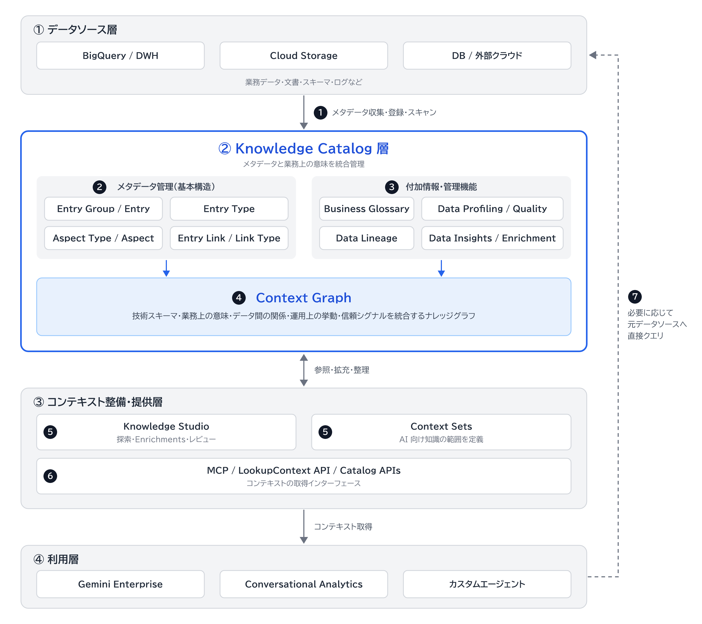

# Knowledge Catalog の全体像

Knowledge Catalog は、構造化・非構造化データにまたがって技術メタデータと業務上の意味を統合する Google Cloud のサービス。\
旧称は Dataplex Universal Catalog。\
データ資産の発見、データ品質の検証、生成 AI アプリの[グラウンディング](glossary/グラウンディング.md)に使う。

データそのものは動かさず、メタデータを集め、業務上の意味と信頼の情報を足し、AI やユーザーに渡す。\
公式ドキュメントはこれを集約、拡充、検索と取得の 3 つの柱と呼ぶ。\
柱の内容は [メタデータのライフサイクル](architecture/メタデータのライフサイクル.md) にある。

## 全体構成図

黒丸の番号は、下の「一連の流れ」の順に対応する。\
4 つの層はこの資料群での整理であり、公式の区分ではない。

## 一連の流れ

メタデータがデータソースから AI エージェントに届くまでの流れ。\
例は、BigQuery の `customer_orders` テーブルを販売分析のエージェントが使う場合。

| 順 | 層 | 起こること | 例 | 資料 |
|---|---|---|---|---|
| 1 | ① | データソースのメタデータが取り込まれる | テーブルを作ると、自動でカタログに登録される | [データソース](architecture/データソース.md) |
| 2 | ② | 資産が Entry、メタデータが Aspect として表される | テーブルが Entry になり、列の一覧が Aspect として付く | [メタデータモデル](architecture/メタデータモデル.md) |
| 3 | ② | 業務上の意味と信頼の情報が足される | `email_address` 列に用語の定義が結ばれ、品質のスコアが付く | [付加情報・管理機能](architecture/付加情報・管理機能.md) |
| 4 | ② | 資産と意味がグラフとしてつながる | テーブルから、用語や結合できるテーブルをたどれる | [Context Graph](architecture/Context-Graph.md) |
| 5 | ③ | AI に渡す範囲がまとめられる | 販売分析用の Context Set に、テーブルの説明、用語、[クエリテンプレート](glossary/クエリテンプレート.md)を入れる | [Knowledge Studio](architecture/Knowledge-Studio.md)、[Context Sets](architecture/Context-Sets.md)、[エンリッチメントタスク](architecture/エンリッチメントタスク.md) |
| 6 | ③ | エージェントがコンテキストを取得する | [MCP](glossary/MCP.md) か API で、用語の定義と結合条件を受け取る | [コンテキストの取得手段](architecture/コンテキストの取得手段.md) |
| 7 | ④ | エージェントがデータに問い合わせる | SQL を生成し、BigQuery で実行する | [利用側](architecture/利用側.md) |

## そのほかの資料

- 特定の状況や疑問を起点に調べた内容: [questions](questions/)
- 用語の定義: [glossary](glossary/)

## 関連

- 公式ドキュメント: [Knowledge Catalog の概要](https://docs.cloud.google.com/knowledge-catalog/docs/introduction)、[データコンテキストについて](https://docs.cloud.google.com/knowledge-catalog/docs/about-context)
